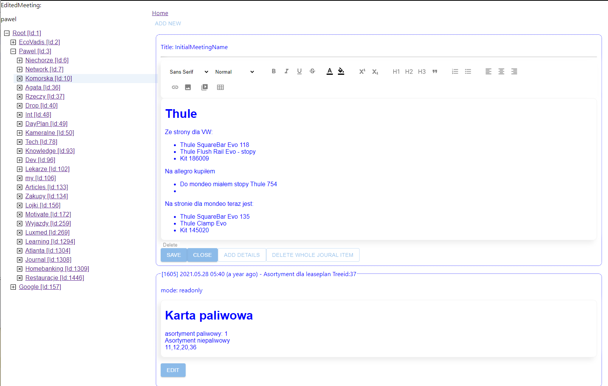

<!--Category:C#,SQL--> 
 

    <a href="http://productivitytools.tech/productivitytools-createsqlserverdatabase/"><a> 
    

    

# Journal Web

Web application which allows to create notes from daily events. The source idea was to create a notes from the meetings. Every meeting could have different parts like before meeting, after meeting during meeting notes

All notes are organized as Facebook wall. The last messages are in the top.

## Offline Mode & Local Caching

Journal Web supports full offline browsing, editing, and on-demand synchronization using a browser-local `IndexedDB` database (`ProductivityToolsJournalOfflineDB`) and an App-Shell Service Worker (`public/offline-sw.js`).

### Data Loading Strategy (Network-First with Offline Fallback)
- **When Online (`Network-First`):**
  - Opening the journal tree or selecting a node fetches the latest data directly from the API first.
  - Every fetched tree structure, note list, and edited/saved note is automatically cached in `IndexedDB` (`meta` and `pages` stores) and merged with any pending local offline edits.
  - Only active (non-archived) notes are fetched and cached.
- **When Offline (`IndexedDB Fallback`):**
  - If the browser is offline (`!navigator.onLine`) or a network request fails, the app automatically falls back to reading the tree and notes from `IndexedDB` (`offlineService.getCachedPagesForSubtree`).
  - Cached subtrees calculate note aggregation recursively (selecting a parent node displays cached notes from the node and all its child nodes).

### Pre-Flight / On-Demand Offline Synchronization
Before going offline (e.g., before a flight), you can pre-cache notes without clicking through individual folders:
- **Sync All Offline** (in the top `SessionBar`): Downloads the entire journal tree and **all** active notes across the whole tree (`FullSync: true`, bypassing the default 50-note API limit) and stores them in `IndexedDB`.
- **Sync tree for offline** (right-click context menu on any tree node) / **Sync Folder Offline** (button in the folder header): Downloads all active notes for the selected subtree (`FullSync: true`) and marks all nodes in that subtree as synced (indicated by a green cloud icon in the tree).

### Offline Editing & Outbox Queue
- While offline, you can create, edit, move, rename, and delete both notes and tree nodes.
- New items created offline receive temporary negative IDs (`tempId`) and are queued in the `IndexedDB` `outbox` store (with automatic operation compaction, e.g., multiple edits to a newly created offline note are merged into a single `CREATE_PAGE` operation).
- When the internet connection is restored (or when clicking **Pending sync: N (Sync now)** in the top bar), queued operations are replayed in order against the API and temporary IDs are remapped to real server IDs.
